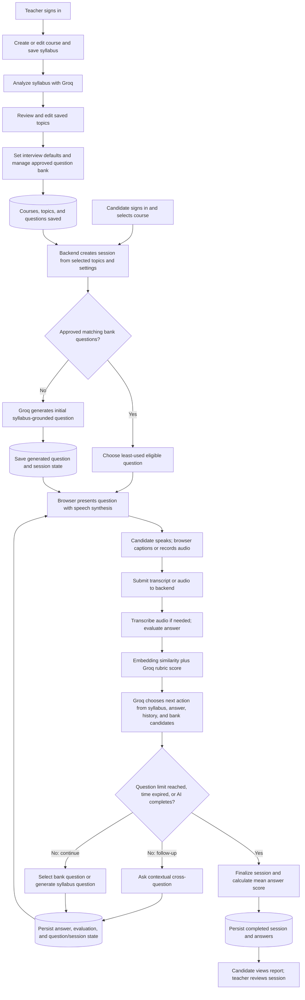
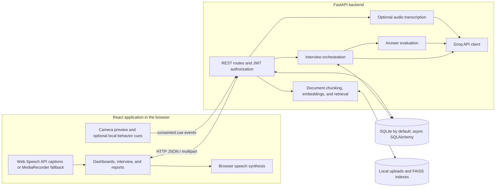

# AI-Based Viva Voce System

**Syllabus-driven oral practice with adaptive, AI-supported questions and answer feedback.**

AI-Based Viva Voce System is a web application for teachers who prepare course material and review practice sessions, and students who rehearse explaining what they know. Teachers save a course syllabus, have Groq analyze it into editable topics, and maintain an approved question bank. A candidate chooses a course and completes a spoken practice interview. The backend evaluates each answer and asks Groq to select or generate the next syllabus-grounded question, including a contextual follow-up when appropriate.

The application provides automated practice feedback for review. It is not a substitute for a teacher's academic judgment.

## Contents

- [Features](#features)
- [How an interview works](#how-an-interview-works)
- [Architecture](#architecture)
- [Technology](#technology)
- [Project layout](#project-layout)
- [Requirements](#requirements)
- [Local setup](#local-setup)
- [Configuration](#configuration)
- [API overview](#api-overview)
- [Data model and storage](#data-model-and-storage)
- [Tests and quality checks](#tests-and-quality-checks)
- [Troubleshooting](#troubleshooting)
- [Current limitations](#current-limitations)

## Features

### Teacher workspace

- Create, edit, and delete courses; save course details and paste or edit the syllabus text.
- Analyze a saved syllabus with Groq. The resulting modules and topics are saved for review, and topic names can be edited.
- Set course defaults for question count, interview duration, difficulty, and selected topics. Leaving topics unselected includes all course topics.
- Create, edit, approve or unapprove, search, filter, paginate, and delete questions in the question bank. Questions carry expected key points, difficulty, tags, and an optional question type.
- Generate question-bank entries for a topic through the API using uploaded topic materials when available. The API supports PDF, TXT, Markdown, CSV, and JSON document uploads and embedding; the current frontend does not expose document upload controls.
- Review sessions, answers, and transcripts; override an answer score with a written reason; export session data as CSV.

### Candidate workspace

- Register a student account, sign in, browse available courses, start a practice viva, and revisit session reports.
- Use a live interview screen with camera preview and microphone controls. In browsers with the Web Speech API, the browser produces live captions. Otherwise, the app records a spoken turn and sends audio to the backend for transcription.
- Hear questions and interviewer responses using the browser's speech synthesis. This is browser-generated voice, not generated audio from Groq.
- See the transcript, per-answer score, rubric breakdown, and overall session score in the report.

### Adaptive interview and evaluation

- Initialize a session from the course's approved questions, selected topics, and configured difficulty. Approved questions are ordered to favor less-used entries.
- If no approved question matches the session, generate the initial question from the saved syllabus and its reviewed topics.
- After each submitted transcript, compute a semantic similarity score and a Groq rubric score. The weighted answer score is 40% embedding similarity and 60% LLM rubric score.
- Ask Groq to choose the next action using the syllabus, recent conversation, answer evaluation, topic coverage, and up to four unused question-bank candidates. It can select a bank entry, generate a new question, ask a contextual follow-up, move to another topic, or complete the interview. Consecutive follow-ups are limited to two when another topic is available.
- Stop when the interview reaches its configured question limit, is completed by the interviewer, or the candidate ends it. The session score is the mean of persisted answer scores.

## How an interview works

This is the main teacher-to-candidate flow. Groq handles syllabus analysis and language-model decisions. The FastAPI backend handles authentication, question selection, answer evaluation, and database writes. Candidate transcript entry and speech playback run in the browser.



## Architecture



The frontend is a Vite-served React single-page application using hash-based routes and an Axios client. In development, Vite proxies `/api` requests to `http://127.0.0.1:8000`; the client can use `VITE_API_URL` as its API base URL. The backend exposes FastAPI REST endpoints, validates JWT bearer tokens and role/course ownership, coordinates interview turns, and persists records through async SQLAlchemy. Groq calls are complete request/response operations in current workflows; the provider supports buffered streaming internally, but the interview UI does not use streamed responses.

## Technology

| Area | Implementation |
|---|---|
| Frontend | React 18, Vite 6, Axios |
| Backend | Python 3.11+, FastAPI, Uvicorn, Pydantic Settings |
| Language model | Groq Python SDK; configured model `openai/gpt-oss-120b` |
| Audio | Browser Web Speech API, MediaRecorder, and speech synthesis; optional backend faster-whisper or Groq transcription (`whisper-large-v3-turbo`) |
| Similarity and retrieval | NumPy, sentence-transformers (`all-MiniLM-L6-v2`, local cache only), FAISS CPU; deterministic vector fallback when the embedding model is unavailable |
| Database | SQLAlchemy async ORM; SQLite with aiosqlite by default; async PostgreSQL URL supported by SQLAlchemy/asyncpg when installed |
| Authentication | JWT bearer tokens, bcrypt password hashing, role and ownership checks |
| Migrations | Alembic |
| Optional camera cues | MediaPipe Tasks Vision running in the browser |

There is one LLM provider: Groq. Speech transcription may run locally with the optional `faster-whisper` package; it is a speech-to-text fallback, not another LLM provider. PostgreSQL support is not included as a default dependency in `pyproject.toml`; install a compatible async PostgreSQL driver separately if using that database.

## Project layout

```text
.
├── backend/
│   ├── alembic/              # Database migration environment and revisions
│   ├── app/
│   │   ├── api/              # Auth, courses, topics, questions, viva, reports, consent
│   │   ├── llm/              # Groq provider and prompt templates
│   │   ├── models/           # SQLAlchemy entities
│   │   ├── schemas/          # Request and response validation
│   │   ├── services/         # Interview, evaluation, speech, documents, retrieval
│   │   ├── config.py         # Environment-backed application settings
│   │   ├── database.py       # Async engine and sessions
│   │   └── main.py           # FastAPI app, health endpoints, and API registration
│   ├── tests/                # Pytest suite
│   ├── pyproject.toml        # Backend dependencies and tool configuration
│   └── requirements.txt     # Runtime dependency list
├── frontend/
│   ├── src/api/              # HTTP client
│   ├── src/components/       # Consent, timer, microphone, transcript components
│   ├── src/hooks/            # Authentication and interview state
│   ├── src/pages/            # Teacher, student, interview, and report screens
│   ├── package.json          # Frontend scripts and dependencies
│   └── vite.config.js        # Development server and API proxy
├── .env.example              # Backend configuration template
├── dev.py                    # Starts both development servers
├── Makefile                  # Convenience setup, run, test, and build targets
└── README.md
```

Runtime uploads and vector indexes are stored locally under the backend working directory (`uploads/` and `vector_store/`) and are gitignored. They are created as needed.

## Requirements

- Python 3.11 or newer.
- Node.js and npm. The repository does not pin a Node.js version; use a current Node.js release compatible with Vite 6.
- A Groq account and API key for syllabus analysis, question generation, adaptive interviewer decisions, and answer rubric evaluation.
- A supported browser with camera and microphone access for the live interview. Use localhost or HTTPS for browser media APIs.
- SQLite is ready to use by default. A PostgreSQL server and a compatible async driver are only needed if you choose PostgreSQL.

## Local setup

Commands below use Windows PowerShell. Run the backend and frontend in separate terminals after setup. The root `.env` is loaded by the backend; keep it out of version control.

### 1. Clone and configure the backend

```powershell
git clone <repository-url>
cd <repository-directory>
Copy-Item .env.example .env
```

Edit `.env`: set `GROQ_API_KEY` and replace `SECRET_KEY` with a long, random secret. The default database is SQLite, so no database server setup is required.

```powershell
cd backend
python -m venv .venv
.\.venv\Scripts\Activate.ps1
python -m pip install --upgrade pip
python -m pip install -e ".[dev]"
alembic upgrade head
```

If PowerShell blocks environment activation, either adjust the current user's execution policy according to your environment or invoke the environment's executable directly, for example `\.venv\Scripts\python.exe -m pip install -e ".[dev]"` from `backend\`.

### 2. Install frontend dependencies

In a second PowerShell terminal, from the repository root:

```powershell
cd frontend
npm install
```

### 3. Start the services

Backend terminal, from `backend\`:

```powershell
.\.venv\Scripts\Activate.ps1
uvicorn app.main:app --reload --host 127.0.0.1 --port 8000
```

Frontend terminal, from `frontend\`:

```powershell
npm run dev
```

Open <http://localhost:5173>. API documentation is at <http://127.0.0.1:8000/docs>. Check `GET http://127.0.0.1:8000/api/health` for database connectivity, then `GET http://127.0.0.1:8000/api/health/ai` to make a real Groq completion request.

Alternatively, after installing both dependency sets, run `python dev.py` from the repository root to start both development servers.

### Optional development data

`backend/app/scripts/seed.py` contains a development seed script that creates fixed teacher and student accounts and a sample course. It is not needed for normal startup. Review the script before running it; the sample account credentials are hard-coded for development and must not be used in a deployed environment.

## Configuration

The backend reads the project-root `.env` (and environment variables) using Pydantic Settings. The frontend reads `VITE_API_URL` from its own Vite environment; it defaults to an empty base URL, which works with the development `/api` proxy. For a built frontend, configure the API base URL or serve the API on the same origin.

| Variable | Purpose | Required |
|---|---|---|
| `APP_NAME` | API title and application name; default `AI Viva Voce System` | No |
| `DEBUG` | Debug setting; default `false` | No |
| `SQL_ECHO` | Log SQL statements; default `false` | No |
| `API_V1_STR` | API router prefix; default `/api` | No |
| `SECRET_KEY` | Signs and verifies JWT tokens; set a private random value | Yes for secure use; development default is unsafe |
| `ACCESS_TOKEN_EXPIRE_MINUTES` | JWT lifetime; default 1440 | No |
| `DATABASE_URL` | Async SQLAlchemy connection URL; default `sqlite+aiosqlite:///./viva.db` | No for SQLite; required to select another DB |
| `CORS_ORIGINS` | Comma-separated or JSON list of allowed frontend origins | No; defaults to localhost Vite origins |
| `GROQ_API_KEY` | Authenticates backend language-model calls and Groq transcription fallback | Required for Groq features |
| `GROQ_MODEL` | Groq chat model; default `openai/gpt-oss-120b` | No |
| `GROQ_TIMEOUT_SECONDS` | Chat request timeout; default 45 seconds | No |
| `GROQ_STT_MODEL` | Groq audio transcription fallback model; default `whisper-large-v3-turbo` | No |
| `WHISPER_MODEL` | Local faster-whisper model name; default `base` | No; used only when faster-whisper is installed |
| `VITE_API_URL` | Frontend API base URL; blank by default | No in development; configure for deployment as needed |

Create the Groq key in the [Groq Console](https://console.groq.com/) and set it only in the backend environment. Never prefix the key with `VITE_` or include it in frontend code, commits, logs, or screenshots. `.env.example` contains placeholders, not credentials.

`GET /api/health/ai` verifies the configured Groq model by making a real completion request. A successful `/api/health` response only confirms that the API can reach its database. Authentication failures, connection errors, timeouts, rate limits, and invalid model/request responses are surfaced as API errors; the backend does not switch providers.

## API overview

All application routes below use the `/api` prefix. Protected routes require `Authorization: Bearer <token>`; teacher operations also require a teacher or admin role, with teacher course ownership enforced. Schemas and interactive request examples are available at `/docs`.

| Method and route | Purpose | Access |
|---|---|---|
| `POST /auth/register` | Create a student account and return a bearer token; public registration does not allow teacher roles | Public |
| `POST /auth/login`, `GET /auth/me` | Authenticate and retrieve the current profile | Login public; `me` authenticated |
| `GET /health`, `GET /health/ai` | Check database/API health; make a live Groq connectivity check | Public |
| `GET/POST /courses`, `GET/PUT/DELETE /courses/{course_id}` | List or manage courses; course payload includes syllabus and interview settings | Authenticated; writes teacher/admin |
| `POST /courses/{course_id}/syllabus/analyze` | Analyze saved syllabus text with Groq and persist topics | Teacher/admin owner |
| `POST /topics/{topic_id}/questions/generate` | Generate question-bank entries for a topic | Teacher/admin owner |
| `GET /questions`, `POST /questions`, `PUT /questions/{question_id}`, `DELETE /questions/{question_id}` | Search/paginate and manage question-bank entries | Authenticated; writes teacher/admin |
| `POST /viva/sessions`, `GET /viva/sessions`, `GET /viva/sessions/{session_id}` | Start and inspect a candidate session | Authenticated; ownership applies |
| `POST /viva/sessions/{session_id}/next` | Fetch the next question during session initialization/advancement | Candidate session owner |
| `POST /viva/sessions/{session_id}/turn` | Submit a transcript, evaluate it, and receive the adaptive next interviewer turn | Candidate session owner |
| `POST /viva/sessions/{session_id}/turn/audio` | Submit an audio turn for backend transcription and processing | Candidate session owner |
| `POST /viva/sessions/{session_id}/finish` | Finish and summarize an interview | Candidate session owner |
| `GET /viva/sessions/{session_id}/report`, `GET /teacher/sessions` | View a candidate report or teacher session list | Authenticated; ownership/role applies |
| `PUT /viva/sessions/{session_id}/scores/{answer_id}`, `GET /reports/export` | Record a teacher score override or export CSV | Teacher/admin |
| `POST/GET /consent`, `POST /consent/revoke` | Record, inspect, or revoke session consent | Authenticated |

The backend also provides topic, document, and user audio-management routes. See the generated OpenAPI page for their full schemas. Most invalid or inaccessible requests return standard FastAPI `4xx` responses; Groq and transcription failures can return `5xx`, while Groq rate limits are reported as `429`.

## Data model and storage

The SQLAlchemy database stores:

- `User`: student, teacher, or admin account and hashed password.
- `Course`: owner, course metadata, original syllabus text, Groq syllabus analysis, and interview defaults.
- `Topic`: ordered topic belonging to a course.
- `Question`: question-bank or generated question, topic, expected key points, difficulty, type, approval status, and use count.
- `VivaSession`: candidate, course, lifecycle status, limits, question index, configuration and topic coverage, and final mean score.
- `Answer`: transcript, evaluation scores and rubric, question/session association, and optional local audio path.
- `Consent` and `ScoreOverride`: consent records and auditable teacher score adjustments.
- `Document`: uploaded topic material metadata and embedding status.

The course syllabus and analysis are stored in the course row; session question order and adaptive coverage state are stored in the session configuration. Uploaded documents, audio files, FAISS indexes, and chunk metadata are stored on the local filesystem rather than in the database. The question and answer records persist generated prompts and results. The small response cache used by LLM services is process-local and temporary.

Apply schema changes with `alembic upgrade head` from `backend\`. This creates/updates the configured database. The default SQLite file is relative to the backend process working directory. No database reset command is provided; back up persisted data before manually removing a database or local uploads.

## Tests and quality checks

Run commands from `backend\` unless stated otherwise:

```powershell
.\.venv\Scripts\Activate.ps1
pytest
ruff check app tests
ruff format --check app tests
```

Build the frontend from `frontend\`:

```powershell
npm run build
```

The backend tests are configured with pytest and an isolated in-memory SQLite database. A Groq integration test is skipped unless a Groq API key is configured. The frontend package currently defines development, build, and preview scripts; it does not define a test or lint script.

## Troubleshooting

- **Groq reports missing credentials or authentication failure:** confirm `GROQ_API_KEY` is set in the repository-root `.env`, with no quotes or placeholder value, and restart the backend. Check `/api/health/ai` to test the configured model. Do not expose the key in a frontend variable.
- **Groq returns a model, access, or rate-limit error:** verify the model identifier/access in Groq and retry after rate limiting. `/api/health` does not test Groq.
- **Frontend cannot reach the API:** check that Uvicorn is running on port 8000 and Vite on port 5173. The Vite development proxy targets `127.0.0.1:8000`. For a different deployment origin, set `VITE_API_URL` and ensure the backend `CORS_ORIGINS` includes the frontend origin.
- **Database connection or migration fails:** verify `DATABASE_URL`, install a matching async database driver, and run `alembic upgrade head` from `backend\` in the same environment as the backend. The default SQLite URL creates a local file relative to the backend working directory.
- **Python imports fail or the wrong packages are used:** activate `backend\.venv` and install `python -m pip install -e ".[dev]"` from `backend\`.
- **Camera/microphone access is denied:** allow site permissions and use localhost or HTTPS. The interview needs microphone input; video can be switched off after granting media access. Browser media APIs may be unavailable on insecure non-local origins.
- **Live captions are missing:** the Web Speech API varies by browser. The application falls back to recording each utterance and submitting audio. This backend path requires local `faster-whisper` or a working Groq transcription configuration. Optional local installation: `python -m pip install faster-whisper` from the backend virtual environment; the configured Whisper model may need to download on first use.
- **Interviewer voice is unavailable:** enable browser speech synthesis or use a browser that implements `speechSynthesis`. Groq returns text; it does not provide the interview voice.

## Current limitations

- Live captions and speech playback depend on browser capabilities and permissions. Fallback transcription runs on the backend and can use a local model or Groq's transcription endpoint.
- Camera behavior cues are optional, computed locally in the browser, and stored as session flags when consent is granted. The UI labels them as approximate context only; they do not affect interview scores.
- The candidate report exposes the overall score, per-answer score, transcript, and numeric rubric breakdown. It does not currently provide a separate topic-by-topic mastery report or written strengths/weaknesses summary.
- Uploaded document processing and question generation are supported by backend endpoints, but document upload controls are not present in the current teacher dashboard.
